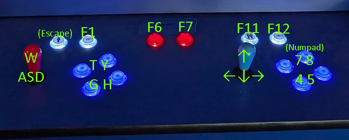
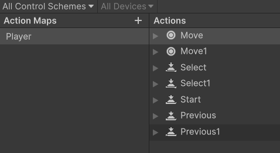

# Pain
In the age of Flash deprecation, one might think that games where a keyboard is shared by multiple players could be made in an engine like Unity. While it's possible, I've found that a shared controller is a second-class citizen to the engine assuming that all players have their own controller.

I discovered this while making [my project](/2026/10/01/root4Strikes.html) for the 2026 IGDA Cincinnati Arcade Jam, in which participants created games designed for a specific 1-2 player Arcade Cabinet.

## The Setup (?)
Going into the jam, everyone was shown the below graphic which indicated keymappings we should use for the controls of the cabinet. One keyboard is mapped to the buttons of *both* players, such that player 1 wouuld sit on the left of the keyboard, and player two would sit on the right.

This was a graphic I created for the jam, after we were told "the cabinet probably maps to keyboard buttons, they should be configurable." There were issues with this map, like how my laptop for demoing my game didn't have a number pad, but that's the least of my issues; it turns out, **Unity Does *not* like players sharing an input device.**

## Assumptions from Unity's New Input System
As I tested with Unity's input system, I learned several critical features which would be helpful with creating games intended for use with multiple controllers, but which were a huge pain for me as I tried implementing 2 gamers 1 keyboard.

1. Input System assumes 1 Binding in an action map would be shared across all players.
   - This is helpful when creating maps for use with 2+ controllers. One control scheme, and BOOM, all your players are ready to go.

2. Input System assumes each player has a different hardware device; Player Input Manager associates a "player" with a hardware guid.
   - If a player is already using "Controller 1", then that controller's ID is locked to that "Player". This is handled automatically when using the Input Manager to spawn player prefabs which is, again, a very helpful feature if I were making a game that expects 1 controller per player.

Let's look at the different control mapping attempts which led to these assumptions.

### Regular Input Map
I was confident from the get-go that the "default" method for creating controller bindings would not work out for my use case. Due to using 1 "controller" for two players, the usual hardware mapping would not allow us to spawn two different players from the same controller. If there is a way to make this work, I couldn't find it.

### Custom "Configuration" Keyboard Left & Keyboard Right
Unity's input system supports "Control Schemes", in which you can define different "sets" of controls for the same device. I tried setting up different schemes for "Keyboard Left" and "Keyboard Right", in an attempt to use them as different "controllers" and spawn two different players. I was hopeful this would work, but it ended up breaking because there was still only one device guid.

### Pigeon-holed solution:
Given time constraints, I proceeded to hack the Input System and control two different "players" with just the one PlayerInput component. I created a single action map which held actions like "Move" and "Move1", which expect different keyboard buttons to move different players.

Then, instead of spawning in players upon some expected input, I created a script which enabled/disabled player prefabs which were set to "disabled" by default.

## Was it worth it? (almost.)
Turns out there was a mistake in my requriments gathering; the arcade cabinet *actually* emulated 2 xinput controllers, so my two-players one-controller solution wasn't necessary at all for the actual Jam use case.

Despite this, I'm still glad I went through this process. I'm new far more familiar with the new Input system. I also learned that Animators are able to be reset to their default state using a simple one-line function, which is super cool, and which I wouldn't have learned if I was simply spawning and despawning player prefabs.

For next year's Arcade Jam, I'll strive to do a better job of requirements gathering before sending everyone the wrong control scheme.